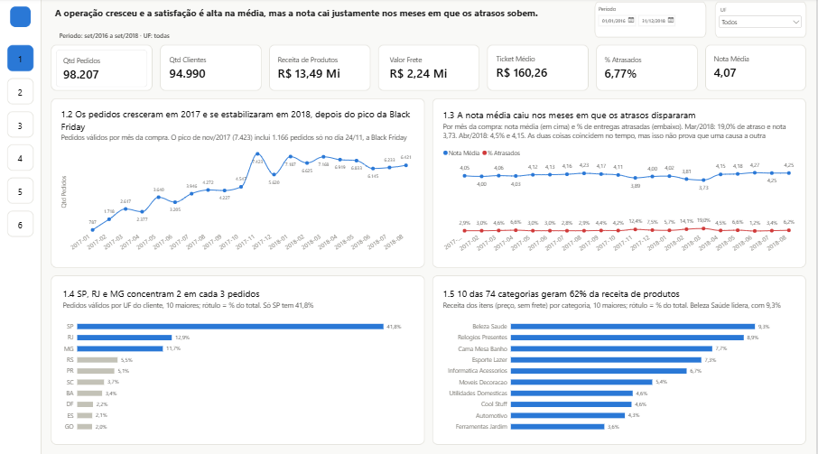
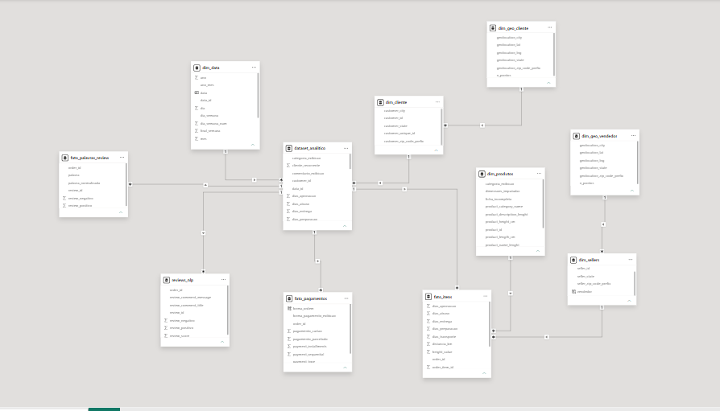
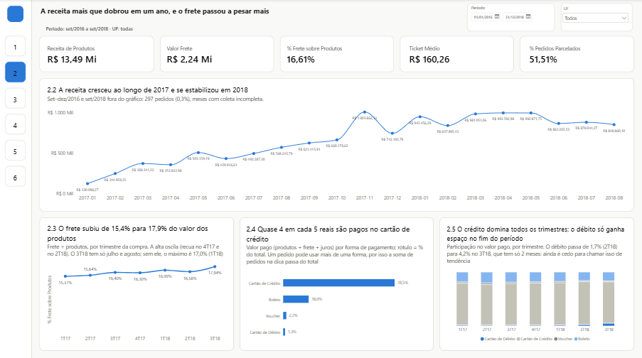
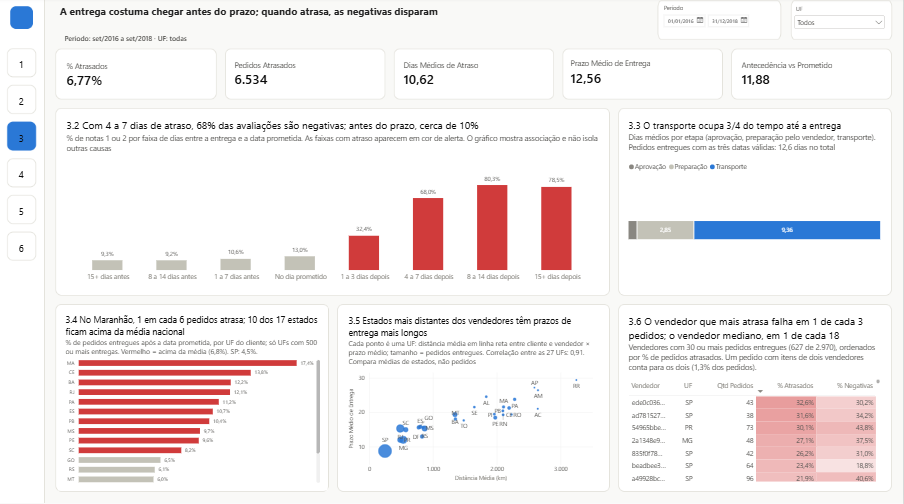
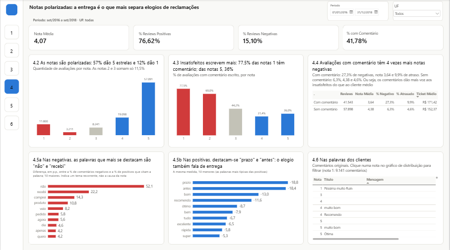
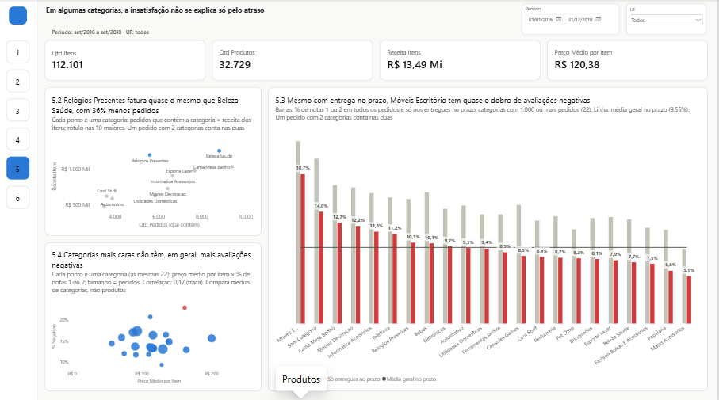
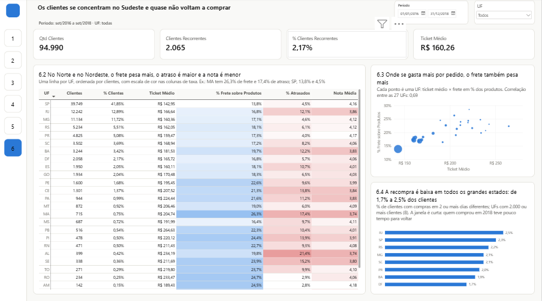

# Análise de E-commerce — Olist

Análise de ~100 mil pedidos de um marketplace brasileiro (2016–2018) para entender **o que está associado à insatisfação dos clientes**. O projeto vai dos dados brutos ao dashboard: pipeline de ETL em Python com validação de qualidade, modelo dimensional e um relatório de 6 páginas em Power BI construído como uma narrativa.



**Principal achado:** a entrega costuma chegar bem antes do prometido, mas, nos pedidos que atrasam, as avaliações negativas disparam: de cerca de 10% (entregues antes do prazo) para 68% (4 a 7 dias de atraso). Mesmo assim, o atraso não explica tudo: algumas categorias têm o dobro de insatisfação mesmo com entrega no prazo.

---

## Contexto e perguntas de negócio

A Olist conecta pequenos vendedores a grandes marketplaces. Cada pedido passa por pagamento, preparação pelo vendedor, transporte e avaliação do cliente. O projeto parte de uma pergunta central:

> **A experiência de entrega está associada à avaliação que o cliente dá? E o que mais pode explicar a insatisfação?**

E de perguntas de apoio, uma por página do dashboard:

| Página | Pergunta |
|---|---|
| Visão Geral | Como está o desempenho geral do negócio? |
| Financeiro | Como a receita evoluiu e de onde vem o dinheiro? |
| Logística | O atraso está associado a avaliações piores? Onde ele se concentra? |
| Reviews | O que os clientes escrevem, e o que separa uma avaliação negativa de uma positiva? |
| Produtos | A insatisfação de uma categoria se explica só pelo atraso? |
| Clientes | Onde estão os clientes, o comportamento muda entre estados, e eles voltam a comprar? |

## Dados

[Brazilian E-Commerce Public Dataset by Olist](https://www.kaggle.com/datasets/olistbr/brazilian-ecommerce) (Kaggle, versão 7), licença **CC BY-NC-SA 4.0**.

- **Volume:** 99.441 pedidos, 112.650 itens, 3.095 vendedores, 9 arquivos CSV (~126 MB).
- **Período:** setembro de 2016 a setembro de 2018. Os meses das pontas têm coleta incompleta e ficam fora dos gráficos de tendência.
- **Granularidade:** é o ponto que exige mais cuidado. Um **pedido** pode ter vários **itens**, cada item pode vir de um **vendedor** diferente, e um pedido pode ter várias **formas de pagamento**. Cada tabela foi tratada no seu próprio grão, para que nenhuma junção conte o mesmo pedido mais de uma vez.

Os dados não estão no repositório. Veja [Como reproduzir](#como-reproduzir).

## Ferramentas

| Ferramenta | Uso |
|---|---|
| **Python** (pandas, numpy) | Inspeção, limpeza, criação de variáveis e tabelas analíticas |
| **Pandera** | Contrato de validação: tipos, chaves, faixas de valores e regras entre colunas |
| **pyarrow** | Gravação das tabelas tratadas em Parquet |
| **Power BI** | Modelo dimensional, medidas DAX e dashboard |

## Pipeline de ETL

```text
9 CSVs do Kaggle
      ↓
Inspeção ............ linhas, nulos, duplicados e chaves de cada tabela
      ↓
Integridade ......... as tabelas se ligam corretamente? (chaves sem correspondência)
      ↓
Limpeza ............. tipos, datas, CEPs, avaliações duplicadas, pagamentos inválidos
      ↓
Variáveis ........... prazos por etapa, atraso, faixas de atraso, recompra, distância
      ↓
Modelagem ........... 3 fatos + 6 dimensões + 2 tabelas de apoio para texto
      ↓
Validação ........... contrato Pandera + conferência dos totais entre tabelas
      ↓
11 arquivos Parquet → Power BI
```

Tudo roda com um comando (`python main.py`). Cada execução gera relatórios de qualidade, e os da última execução estão em [`docs/validacao/`](docs/validacao/).

### Decisões de qualidade de dados

| Problema encontrado | Decisão |
|---|---|
| 1.234 pedidos cancelados ou indisponíveis | Mantidos e sinalizados. Ficam fora da receita, mas suas avaliações contam |
| 1.382 pedidos com datas fora de sequência (ex.: entrega antes do despacho) | Mantidos nas métricas. Só as durações por etapa ficam vazias |
| 555 pedidos com mais de uma avaliação | Mantida uma avaliação por pedido (a mais recente) |
| 261.831 linhas duplicadas e 42 pontos fora do Brasil na geolocalização | Removidos. A coordenada de cada CEP é a mediana dos pontos restantes |
| O `customer_id` muda a cada pedido | Clientes contados pela pessoa (`customer_unique_id`) |
| Recompra no mesmo dia | Compras no mesmo dia contam como uma só ocasião de compra |

## Modelo de dados

Modelo em estrela, sem relacionamentos bidirecionais. Detalhes em [`docs/modelo_de_dados.md`](docs/modelo_de_dados.md) e nas principais medidas DAX em [`docs/medidas_dax.md`](docs/medidas_dax.md).



## Dashboard

Seis páginas, organizadas como uma história: **contexto → desempenho → problema → voz do cliente → outra explicação → quem são os clientes**. O relatório completo está em PDF em [`powerbi/olist_dashboard.pdf`](powerbi/olist_dashboard.pdf).

Regra de cores usada em todas as páginas: **vermelho** só para atraso e insatisfação, **azul** para o dado neutro e **cinza** para o contexto.

### 1. Visão Geral
Tamanho do negócio, evolução dos pedidos e a relação entre nota média e atrasos ao longo do tempo.


### 2. Financeiro
Receita mensal, peso do frete sobre o valor dos produtos e formas de pagamento.


### 3. Logística
Avaliações negativas por faixa de atraso, etapas do prazo de entrega, atraso por estado, distância × prazo e vendedores com mais atrasos.


### 4. Reviews
Distribuição das notas, quem escreve comentários e as palavras que mais separam avaliações negativas de positivas.


### 5. Produtos
Volume e receita por categoria e a insatisfação por categoria **só entre pedidos entregues no prazo**, para separar o efeito do atraso.


### 6. Clientes
Perfil de cada estado (ticket, frete, atraso, nota) e taxa de recompra.


## Principais insights

Cada item indica se é uma **observação** (o que os dados mostram), um **insight** (a leitura para o negócio) ou uma **hipótese** (explicação possível, ainda não testada).

1. **Observação:** a promessa de entrega é folgada. Em média, o pedido chega **11,9 dias antes** do prometido, e só **6,8%** atrasam.
2. **Observação:** quando atrasa, a insatisfação dispara. As avaliações negativas (nota 1 ou 2) ficam em torno de **10%** nos pedidos entregues antes do prazo, sobem para **32%** com 1 a 3 dias de atraso e chegam a **68%** com 4 a 7 dias.
3. **Observação:** nos meses de pico de atraso, a nota média caiu. Em março de 2018, 19% dos pedidos atrasaram e a nota média foi 3,73, contra 4,07 no período todo.
4. **Insight:** o transporte ocupa **74%** do tempo entre a compra e a entrega (9,4 de 12,6 dias). É a etapa com mais espaço para ganho.
5. **Observação:** o atraso se concentra em alguns estados. No Maranhão, 1 em cada 6 pedidos atrasa; em São Paulo, 1 em cada 22. Entre os estados, o prazo médio acompanha a distância até os vendedores (correlação de 0,91 entre as médias estaduais).
6. **Observação:** o atraso não explica toda a insatisfação. Mesmo entre pedidos **entregues no prazo**, Móveis Escritório tem **18,7%** de avaliações negativas, quase o dobro da média (9,55%).
   - **Hipótese:** montagem, avarias ou descrição do produto. Testar exigiria ler os comentários dessas categorias.
7. **Observação:** o preço quase não se associa à insatisfação. A correlação entre as 22 maiores categorias é de 0,17 e cai para −0,01 sem Móveis Escritório.
8. **Observação:** a entrega também domina o que os clientes escrevem. "Não recebi" aparece em 17% dos comentários negativos e em 0,4% dos positivos; "antes do prazo" aparece em 15% dos positivos.
9. **Observação:** a recompra é baixa e parecida em todos os grandes estados: só **2,2%** dos clientes voltaram a comprar, com variação de 1,7% a 2,5% entre eles.

**Conclusão:** os dados mostram uma **associação** forte e consistente entre atraso e insatisfação, em vários recortes. Isso aponta a logística, em especial o transporte e alguns estados, como o principal ponto de atenção. Mas os dados **não permitem concluir que o atraso causa** a nota baixa. Um produto avariado no transporte, por exemplo, pode atrasar e irritar ao mesmo tempo.

## Limitações

- **Associação não é causa.** Nenhuma análise aqui isola o efeito do atraso.
- **Os dados terminam em 2018** e as pontas do período são incompletas.
- **A distância é em linha reta** entre os centróides dos CEPs, não a rota real.
- **O atraso é medido no pedido.** Nos 1,3% de pedidos com mais de um vendedor, todos os vendedores recebem o mesmo atraso.
- **Os comentários representam mais os insatisfeitos.** 77,5% das notas 1 têm comentário, contra 36% das notas 5.
- **A recompra tem janela curta.** Clientes que compraram em 2018 tiveram pouco tempo para voltar.
- **A categoria "do pedido" é um representante.** Análises por categoria usam a categoria de cada produto.

## Como reproduzir

Requisitos: Python 3.11 ou superior (testado com 3.14) e Power BI Desktop.

```bash
# 1. Clone o repositório
git clone https://github.com/Barabarr/olist-ecommerce-analysis.git
cd olist-ecommerce-analysis

# 2. Baixe os 9 CSVs do Kaggle e coloque em data/raw/
#    https://www.kaggle.com/datasets/olistbr/brazilian-ecommerce

# 3. Crie o ambiente virtual e instale as dependências
python -m venv .venv
.venv\Scripts\activate          # Windows (no Linux/macOS: source .venv/bin/activate)
pip install -r requirements.txt

# 4. Rode o pipeline: gera os 11 Parquets em data/processed/
python main.py
```

5. Abra `powerbi/olist_dashboard.pbix`. Para atualizar com os seus dados, aponte a fonte para a sua pasta `data/processed/` em **Transformar dados → Configurações da fonte de dados**.

Para apenas visualizar o relatório, não é preciso rodar nada: veja as imagens acima ou o [PDF](powerbi/olist_dashboard.pdf).

## Estrutura do repositório

```text
├── main.py              ← ponto de entrada do pipeline
├── etl/                 ← módulos: leitura, limpeza, variáveis, modelagem e validação
├── docs/                ← modelo de dados, medidas DAX e relatórios de validação
├── powerbi/             ← .pbix, PDF, tema de cores e fundos das páginas
├── images/              ← imagens deste README
└── requirements.txt
```

## Fonte e licença

- Dados: Olist, [Brazilian E-Commerce Public Dataset](https://www.kaggle.com/datasets/olistbr/brazilian-ecommerce), licença [CC BY-NC-SA 4.0](https://creativecommons.org/licenses/by-nc-sa/4.0/).
- Código: licença MIT (ver [`LICENSE`](LICENSE)).

---

**Autoria:** Barbara Brandalize · [LinkedIn](https://www.linkedin.com/in/barbarabrandalize/)
