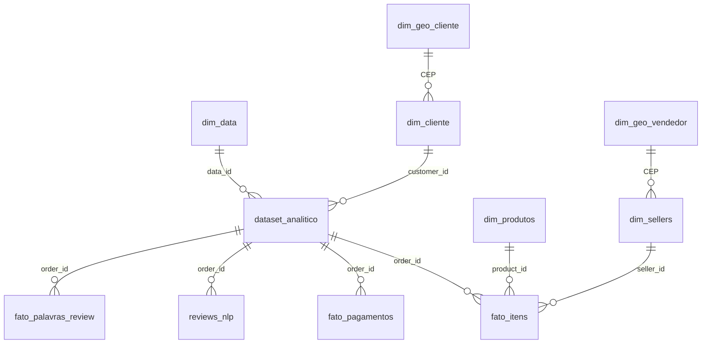

# Modelo de dados

Modelo em estrela no Power BI. Três fatos em grãos diferentes (pedido, item e pagamento) cercados por dimensões. **Nenhum relacionamento é bidirecional**: quando uma medida precisa que o filtro suba do produto para o pedido, ela faz isso só dentro do próprio cálculo (ver [medidas_dax.md](medidas_dax.md)).

Todas as relações são muitos-para-um, com o filtro fluindo do lado "um" para o lado "muitos".

## Tabelas

| Tabela | Tipo | Uma linha por… | Linhas |
|---|---|---|---|
| `dataset_analitico` | Fato | pedido (todos os status) | 99.441 |
| `fato_itens` | Fato | item de pedido | 112.650 |
| `fato_pagamentos` | Fato | forma de pagamento usada no pedido | 103.883 |
| `reviews_nlp` | Apoio (texto) | pedido cuja avaliação tem comentário | 41.543 |
| `fato_palavras_review` | Apoio (texto) | ocorrência de palavra num comentário | 298.319 |
| `dim_data` | Dimensão | dia (01/01/2016 a 31/12/2018) | 1.096 |
| `dim_cliente` | Dimensão | `customer_id` (um por pedido) | 99.441 |
| `dim_produtos` | Dimensão | produto | 32.951 |
| `dim_sellers` | Dimensão | vendedor | 3.095 |
| `dim_geo_cliente` | Dimensão | prefixo de CEP de cliente | 14.836 |
| `dim_geo_vendedor` | Dimensão | prefixo de CEP de vendedor | 2.239 |

## Regras que o modelo respeita

- **Pedidos válidos.** `dataset_analitico` guarda todos os pedidos. A coluna `pedido_valido_receita = 0` marca os 1.234 cancelados ou indisponíveis. As medidas financeiras, logísticas e de clientes usam só os válidos. As de avaliação usam todos, porque a avaliação de um pedido cancelado também é experiência do cliente.
- **Cliente real.** No Olist, `customer_id` muda a cada pedido. A pessoa é `customer_unique_id`, e é ela que as medidas de clientes contam.
- **Um pedido, vários itens.** Um pedido pode ter itens de vendedores e categorias diferentes. Para contar pedidos por produto ou vendedor, o modelo usa medidas "pedidos que contêm": um pedido com itens de duas categorias conta nas duas.
- **Categoria do pedido × categoria do produto.** `dataset_analitico[categoria_exibicao]` é uma categoria representante do pedido inteiro. Análises por categoria usam `dim_produtos[categoria_exibicao]`.
- **Atraso só existe para pedidos entregues.** `pedido_atrasado` fica vazio nos pedidos não entregues, e `dias_atraso` conta dias de calendário em relação à data prometida.
- **Distância é em linha reta.** `distancia_km` usa a fórmula de Haversine entre os centróides dos CEPs do cliente e do vendedor. Não é a rota percorrida.

## Principais colunas criadas no ETL

| Coluna | Tabela | O que indica |
|---|---|---|
| `pedido_valido_receita` | `dataset_analitico` | 1 = pedido válido; 0 = cancelado ou indisponível |
| `dias_aprovacao`, `dias_preparacao`, `dias_transporte`, `dias_entrega` | `dataset_analitico` | Duração de cada etapa, em dias fracionários |
| `dias_atraso`, `pedido_atrasado` | `dataset_analitico` | Dias em relação à data prometida (negativo = adiantado) e 1 se chegou depois |
| `faixa_atraso`, `faixa_atraso_ordem` | `dataset_analitico` | Faixa de antecedência ou atraso (de "15+ dias antes" a "15+ dias depois") e a ordem para os gráficos |
| `flag_datas_inconsistentes` | `dataset_analitico` | 1.382 pedidos com datas fora de sequência. Continuam nas métricas; só as durações por etapa ficam vazias |
| `numero_pedido_cliente`, `cliente_recorrente` | `dataset_analitico` | Ordem da compra do cliente. Compras no mesmo dia contam como uma só |
| `comentario_exibicao` | `dataset_analitico` | Com ou sem comentário escrito na avaliação |
| `distancia_km` | `fato_itens` | Distância em linha reta entre cliente e vendedor |
| `palavra` | `fato_palavras_review` | Palavra do comentário, sem stopwords; "nao" e "não" contam como a mesma |
